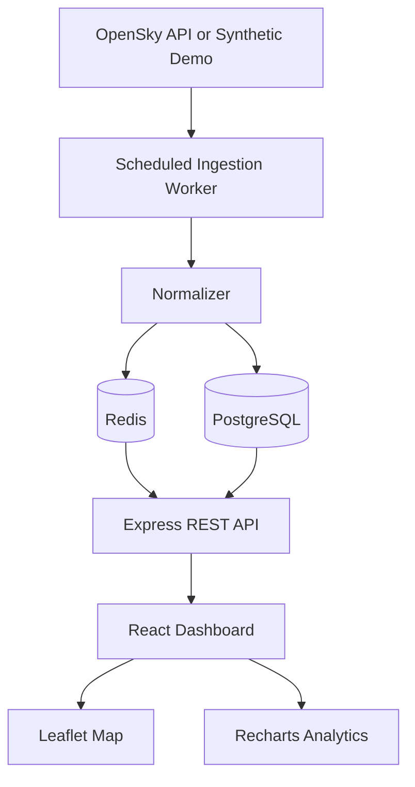

# Architecture

## Reliability decisions
- One shared polling job prevents per-user upstream quota consumption.
- Last in-process or Redis snapshot is used on upstream failure, marked stale.
- PostgreSQL unique `(icao24, observedAt)` avoids duplicate observations.
- History endpoint limits records to 100 and uses an indexed time filter.
- Frontend requests are cached and polled by TanStack Query.

## Future improvements
- Redis distributed ingestion lock for multi-replica deployments.
- Persistent last-known snapshot with no expiration for prolonged upstream outages.
- Paginated history endpoints, retention policies, observability dashboards.
- Separate worker deployment and event-driven updates.
